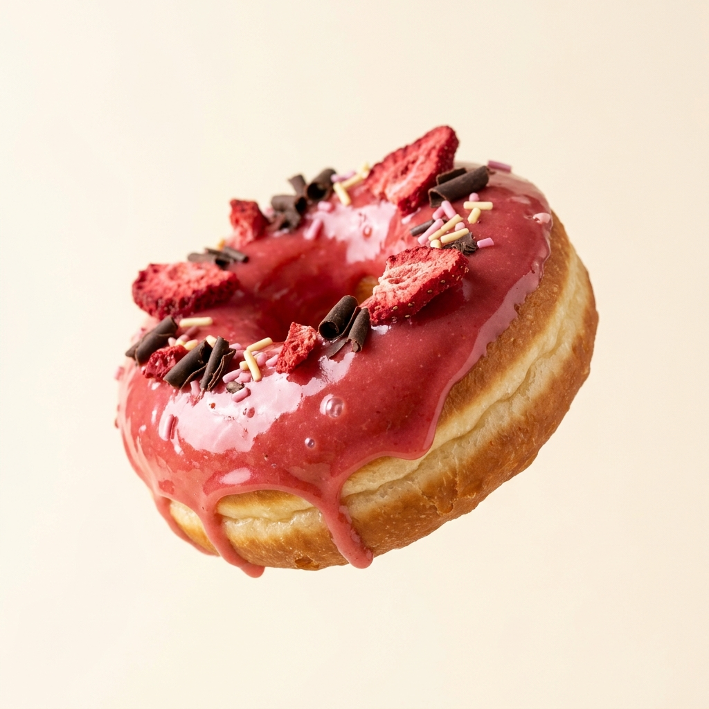

<div align="center">


# DONUTVERSE

### *A Little Hole Lot of Happiness.*

An editorial, tactile artisan donut storefront featuring a real-time procedural 3D glaze studio, interactive shopping bag, and silky scroll-driven motion.

[](https://react.dev/)
[](https://www.typescriptlang.org/)
[](https://vite.dev/)
[](https://docs.pmnd.rs/react-three-fiber)
[](https://tailwindcss.com/)

<br />



</div>

---

## Highlights

- **Interactive 3D Glaze Atelier** — Inspect a procedural Three.js brioche donut crafted with canvas-generated crumb grain & bump maps, custom glaze sheen, studio `Lightformer` reflections, seeded sprinkles, `OrbitControls` drag-to-spin, cursor-reactive tilt, and live flavor switching — backed by a `WebGLErrorBoundary` photo fallback.
- **Curated Artisan Menu** — Browse 6 handcrafted flavors (`Strawberry Dream`, `Belgian Chocolate Bliss`, `Matcha Cloud`, `Classic Glazed`, `Oreo Crunch`, `Raspberry Velvet`) with instant category filtering (`All`, `Fruity`, `Chocolate`, `Classic & Tea`) and MYR pricing.
- **Slide-Over Box & Promo Checkout** — Add items from any card or the 3D studio, manage quantities in a spring-animated cart drawer, trigger live toast notifications, apply code `SWEET15` for **15% OFF**, and complete a simulated checkout with a generated `DV-XXXXXX` order reference.
- **Editorial Motion with Accessibility Built In** — Combines GSAP `ScrollTrigger` reveals, Framer Motion transitions, and custom `MagneticButton` micro-interactions while honoring `prefers-reduced-motion` via `usePrefersReducedMotion`.
- **Boutique Experience End-to-End** — Includes Brand Story, Why Choose Us, Customer Testimonials, Promotional Offer Banner, Interactive Kuala Lumpur & Penang Boutique Selector, and Newsletter Signup.
- **Performance-Minded Build** — Lazy-loaded 3D experience via `React.lazy` + `Suspense`, paired with Rollup manual chunk splitting for `three` and `motion` dependencies.

---

## Tech Stack

| Layer | Technologies |
| --- | --- |
| **Framework & Language** | React 18, TypeScript 5.6, Vite 6 |
| **3D & WebGL** | Three.js, `@react-three/fiber`, `@react-three/drei` |
| **Styling & Typography** | Tailwind CSS 3.4, Fraunces (display), Plus Jakarta Sans (body), Lucide Icons |
| **Motion & Interactions** | GSAP (`ScrollTrigger`), Framer Motion |

---

## Quick Start

### Prerequisites

- Node.js 18+ and npm

### Install & Run Locally

```bash
# 1. Clone the repository
git clone https://github.com/risterz/donutverse.git
cd donutverse

# 2. Install dependencies
npm install

# 3. Start the development server
npm run dev
```

### Scripts

| Command | Description |
| --- | --- |
| `npm run dev` | Start Vite dev server with hot module replacement |
| `npm run build` | Type-check with `tsc -b` and build production bundle to `dist/` |
| `npm run preview` | Locally preview the production build |

> **Tip:** Open the cart drawer or click **GET MY DISCOUNT** in the promo section and try code `SWEET15` for 15% off your box.

---

## Project Structure

```text
donutverse/
├── public/
│   ├── favicon.svg
│   └── images/                  # Editorial product, lifestyle & avatar photography
├── src/
│   ├── components/
│   │   ├── Navbar.tsx           # Sticky navigation & live cart badge
│   │   ├── Hero.tsx             # Editorial hero section
│   │   ├── DonutCollection.tsx  # Filterable 6-flavor menu grid
│   │   ├── Donut3DSection.tsx   # Procedural Three.js 3D donut studio
│   │   ├── BrandStory.tsx       # 18-hour brioche craftsmanship narrative
│   │   ├── WhyChooseUs.tsx      # Key quality pillars
│   │   ├── Testimonials.tsx     # Customer reviews
│   │   ├── Promotion.tsx        # SWEET15 first-order offer banner
│   │   ├── Locations.tsx        # Interactive KL & Penang boutique cards
│   │   ├── Newsletter.tsx       # Mailing list signup
│   │   ├── Footer.tsx           # Site footer
│   │   ├── CartDrawer.tsx       # Slide-over shopping bag & checkout flow
│   │   └── MagneticButton.tsx   # Cursor-attracted CTA wrapper
│   ├── context/
│   │   └── CartContext.tsx      # Cart state, totals, promo codes & toasts
│   ├── data/
│   │   └── donuts.ts            # Menu catalog, reviews, boutique locations & MYR formatter
│   ├── hooks/
│   │   └── usePrefersReducedMotion.ts
│   ├── App.tsx
│   ├── main.tsx
│   └── index.css
├── index.html
├── tailwind.config.js           # Custom Cream, Blush, Strawberry, Cocoa & Caramel tokens
├── vite.config.ts               # Rollup chunk splitting (three, motion)
└── package.json
```

---

## Design Tokens

| Role | Palette |
| --- | --- |
| **Backgrounds** | Cream `#FFF8F1`, Warm Cream `#FFFDF9`, Blush `#FCE4EC` |
| **Accents** | Strawberry `#D92B4B`, Caramel `#D18634` |
| **Ink & Dark Stage** | Cocoa `#2A1510`, Deep Cocoa `#1C0D0A` |
| **Typography** | **Fraunces** (soft serif display) · **Plus Jakarta Sans** (clean UI sans) |

---

<div align="center">
  <sub>Freshly baked in React, TypeScript &amp; Three.js.</sub>
</div>
